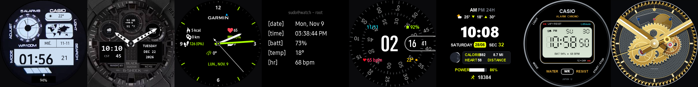
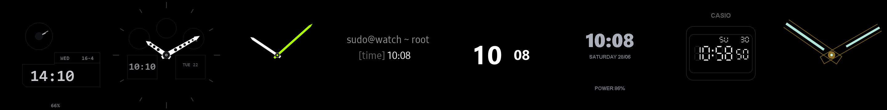

# Reloj Galaxy Watch 3 Tizen



Colección completa de 8 carátulas nativas de alto rendimiento optimizadas para la pantalla circular AMOLED de **360×360 px** del **Samsung Galaxy Watch 3 (`SM-R840`, Tizen OS 5.5.0.2)**, con nombres personalizados en el carrusel, miniaturas reales y scripts de instalación automatizada vía Wi-Fi (SDB).

---

## 📸 Muestra Visual de las Carátulas (Pantalla Activa)

| **Casio Royale** | **G-Shock GA-100** | **MoveToBeActive** | **Terminal Linux** | **Concentric Pixel** | **Odyssey Digital** | **Casio Classic** | **Rolex Skeleton** |
|:---:|:---:|:---:|:---:|:---:|:---:|:---:|:---:|
|  |  |  |  |  |  |  |  |
| *World Time* | *Militar táctico* | *Deportivo Garmin* | *Consola hacker* | *Pixel Watch* | *Wear OS Port* | *Vintage A158W* | *Luxury Tourbillon* |

---

## 🌙 Modo Siempre Encendido (AOD / Ambient Display)



Diseño ultralimpio sobre fondo negro puro AMOLED (`#000000`) con píxeles físicamente apagados para máxima autonomía y protección contra quemado de pantalla (*burn-in*):

| **Casio Royale (AOD)** | **G-Shock GA-100 (AOD)** | **MoveToBeActive (AOD)** | **Terminal Linux (AOD)** | **Concentric Pixel (AOD)** | **Odyssey Digital (AOD)** | **Casio Classic (AOD)** | **Rolex Skeleton (AOD)** |
|:---:|:---:|:---:|:---:|:---:|:---:|:---:|:---:|
|  |  |  |  |  |  |  |  |
| *Marco LCD y hora* | *Lume en manecillas* | *Manecillas flotantes* | *[time] centrado* | *Hora y minutos* | *OLED minimalista* | *Marco LCD y hora* | *Manecillas exclusivas* |

---

## 🌟 Las 8 Carátulas y sus Nombres en el Reloj

| Carátula | Nombre en Pantalla (`DisplayName`) | Ranura Nativa Tizen | Estilo Principal |
| :--- | :--- | :--- | :--- |
| **Casio Royale AE-1200** | `Casio Royale` | `com.samsung.watchface-noblesse-u3` | Digital Retro / Planisferio Mundial |
| **G-Shock GA-100 TacBlack** | `G-Shock GA-100` | `com.samsung.watchface-noblesse-a8` | Táctico Militar Ana-Digi |
| **MoveToBeActive** | `MoveToBeActive` | `com.samsung.watchface-noblesse-a7` | Híbrido Salud / Garmin Vivomove |
| **Terminal Watchface** | `Terminal Linux` | `com.samsung.watchface-noblesse-u1` | Hacker CLI Minimalista 34px |
| **Concentric** | `Concentric Pixel` | `com.samsung.watchface-noblesse-u6` | Google Pixel Watch a 60 fps |
| **Odyssey Digital** | `Odyssey Digital` | `com.samsung.watchface-noblesse-a4` | Wear OS Liberty Port / Neon Yellow Card |
| **Casio Classic A158W** | `Casio Classic` | `com.samsung.watchface-noblesse-a5` | Digital Vintage Retro / Water Resist |
| **Rolex Skeleton Tourbillon** | `Rolex Skeleton` | `com.samsung.watchface-noblesse-a1` | Alta Relojería Mecánica / Engranajes Móviles |

---

### 1. Casio Royale AE-1200 (World Time)
- **Directorio:** [`tizen-native-casio-royale/`](tizen-native-casio-royale/)
- **Slot Nativo:** `com.samsung.watchface-noblesse-u3`
- **Nombre en Reloj:** `Casio Royale`

---

### 2. G-Shock GA-100 TacBlack (Militar Táctico Ana-Digi)
- **Directorio:** [`tizen-native-ga100-tacblack/`](tizen-native-ga100-tacblack/)
- **Slot Nativo:** `com.samsung.watchface-noblesse-a8`
- **Nombre en Reloj:** `G-Shock GA-100`

---

### 3. MoveToBeActive (Analógico Salud Garmin)
- **Directorio:** [`tizen-native-movetobeactive/`](tizen-native-movetobeactive/)
- **Slot Nativo:** `com.samsung.watchface-noblesse-a7`
- **Nombre en Reloj:** `MoveToBeActive`

---

### 4. Terminal Linux (Consola Hacker 34px)
- **Directorio:** [`tizen-native-terminal/`](tizen-native-terminal/)
- **Slot Nativo:** `com.samsung.watchface-noblesse-u1`
- **Nombre en Reloj:** `Terminal Linux`

---

### 5. Concentric Pixel (Pixel Watch 60 fps)
- **Directorio:** [`tizen-native-concentric/`](tizen-native-concentric/)
- **Slot Nativo:** `com.samsung.watchface-noblesse-u6`
- **Nombre en Reloj:** `Concentric Pixel`

---

### 6. Odyssey Digital (Wear OS Port)
- **Directorio:** [`tizen-native-odyssey-digital/`](tizen-native-odyssey-digital/)
- **Slot Nativo:** `com.samsung.watchface-noblesse-a4`
- **Nombre en Reloj:** `Odyssey Digital`

---

### 7. Casio Classic A158W / F-91W (Vintage Alarm Chrono)
- **Directorio:** [`tizen-native-casio-classic/`](tizen-native-casio-classic/)
- **Slot Nativo:** `com.samsung.watchface-noblesse-a5`
- **Nombre en Reloj:** `Casio Classic`

---

### 8. Rolex Skeleton Tourbillon (Mecánica Viva en Tiempo Real)
- **Directorio:** [`tizen-native-rolex-skeleton/`](tizen-native-rolex-skeleton/)
- **Slot Nativo:** `com.samsung.watchface-noblesse-a1`
- **Nombre en Reloj:** `Rolex Skeleton`
- **Características:**
  - **Bisel Acanalado de Oro 18K (Fluted Bezel):** 72 facetas talladas con reflejos dorados y sombras tridimensionales en alta definición.
  - **Corona Rolex y Rehaut:** Icónica corona de 5 puntas a las 12:00, anillo perimetral con minutería fina e índices horarios facetados de oro con material luminiscente Chromalight blanco puro.
  - **Maquinaria Esqueletizada Viva (3 Engranajes Móviles Reales):**
    - **Rueda de Balance / Tourbillon (7:00):** Volante de inercia con 4 brazos y rubí central en chatón de oro que gira de forma continua a 60 fps sincronizado con el escape (`sweep60s`).
    - **Rueda Intermedia de Segundos (4:30):** Engranaje de bronce esqueletizado que contra-rota continuamente sincronizado con los segundos mecánicos.
    - **Gran Rueda Central (Eje 180, 180):** Engranaje dorado de minutos que rota suavemente con el tren de rodaje de la hora.
  - **Manecillas Rolex de Alta Gama:** Agujas facetadas en oro con hendiduras de Chromalight blanco, segundero de barrido continuo ultrafino a 60 fps y pivote central pulido a espejo.
  - **Modo AOD (Always-On Display):** Cumplimiento estricto de ahorro de energía AMOLED; el fondo y los engranajes se apagan por completo (`#000000`), mostrando **exclusivamente las manecillas con lumen tenue** en la oscuridad absoluta para una autonomía prolongada.

---

## 🚀 Instalación Automatizada

### Opción A: Desplegar la colección completa de 8 carátulas (Recomendado)
```powershell
.\instalar_todas_las_caratulas.ps1 -DeviceIp "192.168.100.77:26101"
```

O en Linux / macOS:
```bash
./instalar_todas_las_caratulas.sh 192.168.100.77:26101
```

### Opción B: Instalar Rolex Skeleton individualmente
```powershell
.\install_rolex_skeleton.ps1 -DeviceIp "192.168.100.77:26101"
```

O en Linux / macOS:
```bash
./install_rolex_skeleton.sh 192.168.100.77:26101
```
