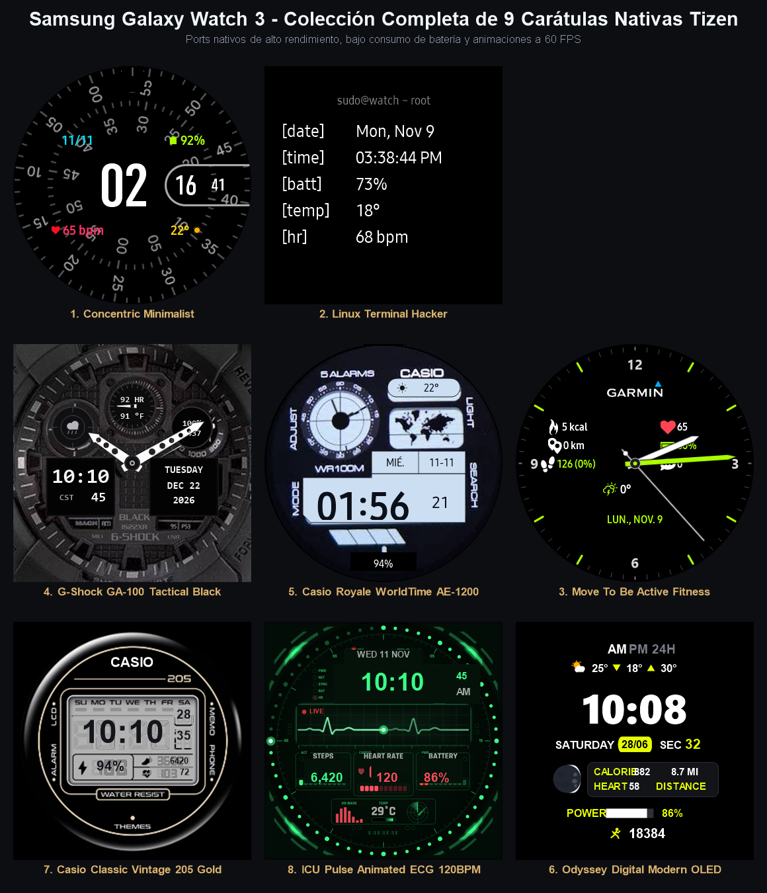
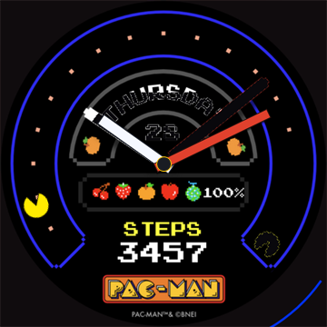
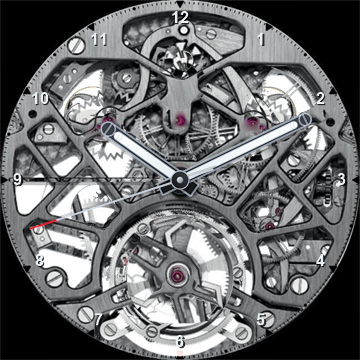
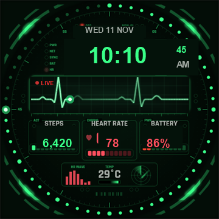
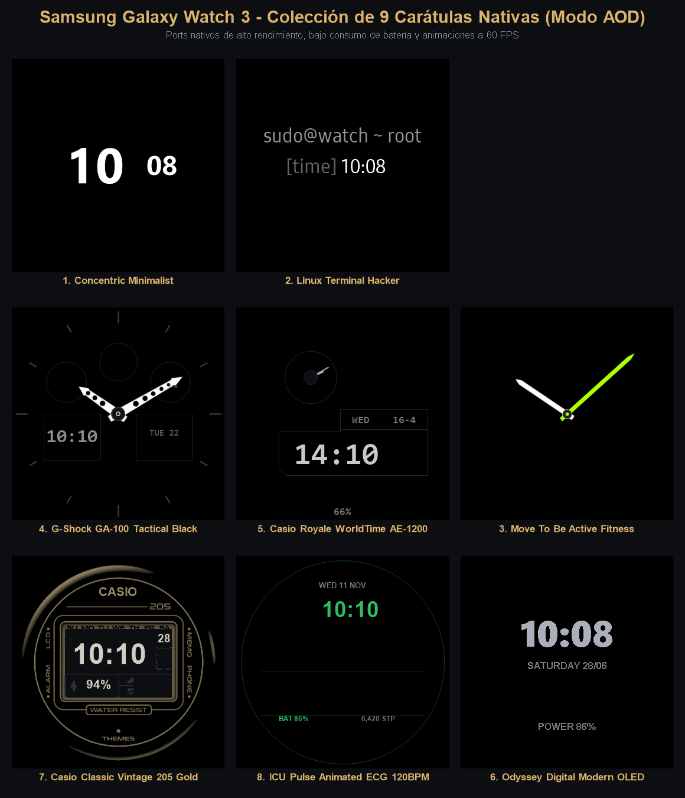
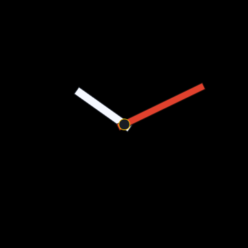
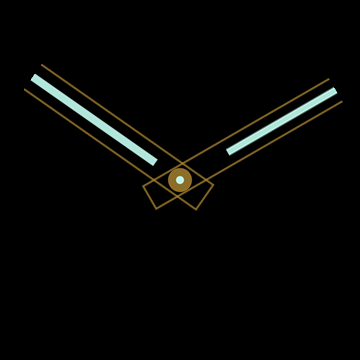
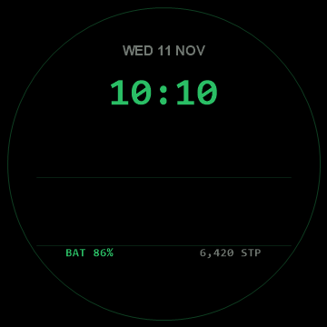

# Reloj Galaxy Watch 3 Tizen



Colección completa de 9 carátulas nativas de alto rendimiento optimizadas para la pantalla circular AMOLED de **360×360 px** del **Samsung Galaxy Watch 3 (`SM-R840`, Tizen OS 5.5.0.2)**, con nombres personalizados en el carrusel, miniaturas reales y scripts de instalación automatizada vía Wi-Fi (SDB).

---

## 📸 Muestra Visual de las Carátulas (Pantalla Activa)

| **Casio Royale** | **PAC-MAN Arcade** | **MoveToBeActive** | **Terminal Linux** | **Concentric Pixel** | **Odyssey Digital** | **Casio Classic** | **Hublot Skeleton 3X** | **ICU Pulse ♪** |
|:---:|:---:|:---:|:---:|:---:|:---:|:---:|:---:|:---:|
|  |  |  |  |  |  |  |  |  |
| *World Time* | *Bandai Namco 60fps* | *Deportivo Garmin* | *Consola hacker* | *Pixel Watch* | *Wear OS Port* | *Vintage A158W* | *3X Gears & Rim* | *Vital Monitor CRT* |

---

## 🌙 Modo Siempre Encendido (AOD / Ambient Display)



Diseño ultralimpio sobre fondo negro puro AMOLED (`#000000`) con píxeles físicamente apagados para máxima autonomía y protección contra quemado de pantalla (*burn-in*):

| **Casio Royale (AOD)** | **PAC-MAN (AOD)** | **MoveToBeActive (AOD)** | **Terminal Linux (AOD)** | **Concentric Pixel (AOD)** | **Odyssey Digital (AOD)** | **Casio Classic (AOD)** | **Hublot Skeleton (AOD)** | **ICU Pulse (AOD)** |
|:---:|:---:|:---:|:---:|:---:|:---:|:---:|:---:|:---:|
|  |  |  |  |  |  |  |  |  |
| *Marco LCD y hora* | *Pistas limpias* | *Manecillas flotantes* | *[time] centrado* | *Hora y minutos* | *OLED minimalista* | *Marco LCD y hora* | *Lume en manecillas* | *Minimal fósforo* |

---

## 🌟 Las 9 Carátulas y sus Nombres en el Reloj

| # | Carátula | Nombre en Pantalla (`DisplayName`) | Ranura Nativa Tizen | Estilo Principal |
| :-: | :--- | :--- | :--- | :--- |
| **1** | **Casio Royale AE-1200** | `Casio Royale` | `com.samsung.watchface-noblesse-u3` | Digital Retro / Planisferio Mundial |
| **2** | **PAC-MAN Arcade Chase** | `Pac-Man Arcade` | `com.samsung.watchface-noblesse-a8` | Arcade Clásico / Segundero 60 fps |
| **3** | **MoveToBeActive** | `MoveToBeActive` | `com.samsung.watchface-noblesse-a7` | Híbrido Salud / Garmin Vivomove |
| **4** | **Terminal Watchface** | `Terminal Linux` | `com.samsung.watchface-noblesse-u1` | Hacker CLI Minimalista 34px |
| **5** | **Concentric** | `Concentric Pixel` | `com.samsung.watchface-noblesse-u6` | Google Pixel Watch a 60 fps |
| **6** | **Odyssey Digital** | `Odyssey Digital` | `com.samsung.watchface-noblesse-a4` | Wear OS Liberty Port / Neon Yellow Card |
| **7** | **Casio Classic A158W** | `Casio Classic` | `com.samsung.watchface-noblesse-a5` | Digital Vintage Retro / Water Resist |
| **8** | **Hublot Big Bang Skeleton** | `Hublot Skeleton` | `com.samsung.watchface-noblesse-a1` | Alta Relojería / 3X Engranajes + Números |
| **9** | **ICU Pulse ♪** | `ICU Pulse` | `com.samsung.watchface-noblesse-a2` | Monitor Médico UCI / Onda ECG Animada |

---

### 1. Casio Royale AE-1200 (World Time)
- **Directorio:** [`tizen-native-casio-royale/`](tizen-native-casio-royale/)
- **Slot Nativo:** `com.samsung.watchface-noblesse-u3`
- **Nombre en Reloj:** `Casio Royale`

---

### 2. PAC-MAN Arcade Chase (Bandai Namco Facer Port)
- **Directorio:** [`tizen-native-pacman-arcade/`](tizen-native-pacman-arcade/)
- **Slot Nativo:** `com.samsung.watchface-noblesse-a8`
- **Nombre en Reloj:** `Pac-Man Arcade`
- **Características:**
  - Laberinto circular arcade en azul neón sobre fondo negro puro AMOLED.
  - Manecillas analógicas retro (blanca para horas, naranja para minutos).
  - **Segundero animado interactivo a 60 fps:** Pac-Man corre por todo el circuito exterior comiendo píldoras y persiguiendo a Blinky, Pinky, Inky y Clyde.
  - Indicadores de batería retro con frutas de 8 bits y contador de pasos.

---

### 3. MoveToBeActive (Analógico Salud Garmin)
- **Directorio:** [`tizen-native-movetobeactive/`](tizen-native-movetobeactive/)
- **Slot Nativo:** `com.samsung.watchface-noblesse-a7`
- **Nombre en Reloj:** `MoveToBeActive`

---

### 4. Terminal Linux (Consola Hacker 34px)
- **Directorio:** [`tizen-native-terminal/`](tizen-native-terminal/)
- **Slot Nativo:** `com.samsung.watchface-noblesse-u1`
- **Nombre en Reloj:** `Terminal Linux`

---

### 5. Concentric Pixel (Pixel Watch 60 fps)
- **Directorio:** [`tizen-native-concentric/`](tizen-native-concentric/)
- **Slot Nativo:** `com.samsung.watchface-noblesse-u6`
- **Nombre en Reloj:** `Concentric Pixel`

---

### 6. Odyssey Digital (Wear OS Port)
- **Directorio:** [`tizen-native-odyssey-digital/`](tizen-native-odyssey-digital/)
- **Slot Nativo:** `com.samsung.watchface-noblesse-a4`
- **Nombre en Reloj:** `Odyssey Digital`

---

### 7. Casio Classic Vintage 205 Gold & Black (Port Vintage Retro)
- **Directorio:** [`tizen-native-casio-classic/`](tizen-native-casio-classic/)
- **Slot Nativo:** `com.samsung.watchface-noblesse-a5`
- **Nombre en Reloj:** `Casio Classic`
- **Características:**
  - **Diseño Vintage FASTER 205:** Dial negro brillante con anillos dorados de alta precisión, logotipo vintage **CASIO** en blanco centrado en la parte superior, línea y denominación `205` en oro, e indicador de protección `WATER RESIST` dorado.
  - **Pantalla LCD Multifunción:** Hora digital 7 segmentos nítida en formato 12h/24h, segundos en tiempo real, día del mes en recuadro dedicado, nivel de batería con ícono de rayo (`⚡`), contador de pasos diarios con silueta de calzado deportivo (`👟`) y pulsaciones cardíacas BPM con corazón (`❤️`).
  - **AOD Ultraeficiente:** Modo Always-On Display sobre negro AMOLED absoluto con líneas tenues en oro cepillado y bajo consumo (<8% OPR).

---

### 8. Hublot Big Bang Skeleton Animated (Engranajes 3X y Números en Orilla)
- **Directorio:** [`tizen-native-rolex-skeleton/`](tizen-native-rolex-skeleton/)
- **Slot Nativo:** `com.samsung.watchface-noblesse-a1`
- **Nombre en Reloj:** `Hublot Skeleton`
- **Características:**
  - **Números en la orilla:** Horas del 1 al 12 nítidas y legibles a lo largo del anillo perimetral exterior con sombra suave.
  - **Engranajes a triple velocidad (3x):** Todos los 7 engranajes mecánicos internos (barrilete, rueda central, tren de escape, volante tourbillon) giran al triple de velocidad para un efecto visual dinámico e hipnótico, sin afectar en absoluto la precisión de la hora de las manecillas.
  - **Manecillas de alta relojería:** En oro King Gold 18K con centro luminiscente Super-LumiNova blanco y segundero continuo a 60 fps (sin tonos rosas).
  - **AOD ultralimpio:** Manecillas flotantes luminiscentes sobre negro absoluto.

---

### 9. ICU Pulse ♪ (Monitor Médico UCI / TOMAJA Design Port)
- **Directorio:** [`tizen-native-icu-pulse/`](tizen-native-icu-pulse/)
- **Slot Nativo:** `com.samsung.watchface-noblesse-a2`
- **Nombre en Reloj:** `ICU Pulse`
- **Características:**
  - Monitor hospitalario de cuidados intensivos en fósforo verde esmeralda CRT (`#39FF88`).
  - **Onda de pulso ECG animada:** Línea de barrido osciloscópico continuo en tiempo real sobre la cuadrícula del monitor.
  - **Pulsómetro (Heart Rate):** En rojo coral (`#FF4F5E`) con icono de corazón y lectura en directo conectada a Samsung Health.
  - **Puntos LED de segundos:** Punto verde luminoso que recorre el bisel a 60 fps.
  - **Batería y pasos:** Medidores en verde fósforo y gris de alto contraste.

---

## 🚀 Instalación Automatizada vía Wi-Fi (SDB)

### Requisitos Previos en el Reloj
1. Conectar el reloj y el PC a la **misma red Wi-Fi** (IP del reloj: `192.168.100.77:26101`).
2. Activar **Opciones de desarrollador** y **Depuración SDB** en el reloj.
3. Asegurar que la pantalla del reloj esté encendida para aceptar la confirmación RSA si se solicita.

### Instalar Todas las Carátulas (Recomendado)

En PowerShell:
```powershell
.\instalar_todas_las_caratulas.ps1
```

En Linux / macOS:
```bash
./instalar_todas_las_caratulas.sh
```

### Instalar Carátulas Individualmente
- **PAC-MAN Arcade:** `.\install_pacman_arcade.ps1`
- **ICU Pulse:** `.\install_icu_pulse.ps1`
- **Hublot Big Bang Skeleton:** `.\install_rolex_skeleton.ps1`
- **Casio Classic:** `.\install_casio_classic.ps1`
- **Casio Royale:** `.\install_casio_royale.ps1`
- **Odyssey Digital:** `.\install_odyssey_digital.ps1`
- **Concentric Pixel:** `.\install_concentric.ps1`
- **MoveToBeActive:** `.\install_movetobeactive.ps1`
- **Terminal Linux:** `.\install_terminal.ps1`
