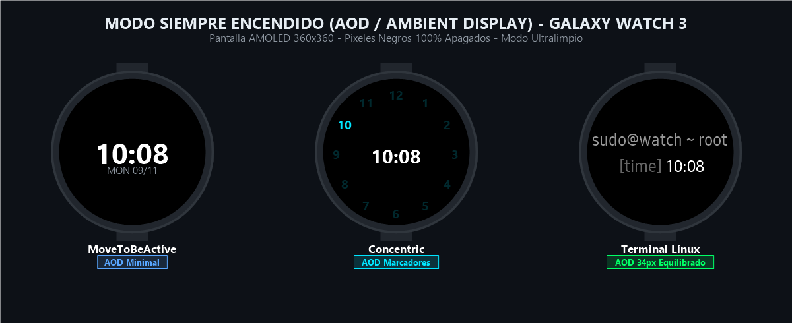

# Reloj Galaxy Watch 3 Tizen


Colección completa de carátulas nativas de alto rendimiento optimizadas para la pantalla circular AMOLED de **360×360 px** del **Samsung Galaxy Watch 3 (`SM-R840`, Tizen OS 5.5.0.2)**, con scripts de instalación automatizada vía Wi-Fi (SDB) tanto de forma individual como en carrusel triple.

---

## 📸 Muestra Visual de las Carátulas (Pantalla Activa)

| **MoveToBeActive (Garmin Vivomove)** | **Terminal Watchface (28px CLI)** | **Concentric (Google Pixel)** |
|:---:|:---:|:---:|
|  |  |  |
| *Analógico híbrido con suite de salud y clima* | *Consola minimalista hacker a 28 px* | *Doble disco concéntrico fluido a 60 fps* |

---

## 🌙 Modo Siempre Encendido (AOD / Ambient Display)



Diseño ultralimpio sobre fondo negro puro AMOLED (`#000000`) con píxeles físicamente apagados para máxima autonomía y protección de pantalla:

| **MoveToBeActive (AOD)** | **Terminal Watchface (AOD)** | **Concentric (AOD)** |
|:---:|:---:|:---:|
|  |  |  |
| *Solo manecillas analógicas flotantes* | *sudo@watch ~ root + [time]* | *Solo números centrales de hora y minutos* |

---

## 🌟 Características de las Carátulas

### 1. MoveToBeActive (Estilo Garmin Vivomove)
- **Directorio:** [`tizen-native-movetobeactive/`](tizen-native-movetobeactive/)
- **Slot Nativo:** `com.samsung.watchface-noblesse-a7`
- **Dial:** Fondo negro puro AMOLED (`#000000`), 60 marcas con índices horarios en verde lima Vivomove (`#AAFF00`) en horas 1, 2, 4, 5, 7, 8, 10 y 11; numerales `12`, `3`, `6` y `9`.
- **Manecillas:** Horaria blanca biselada, minutero verde lima y segundero mecánico con animación de latido continuo (`animation="tick"`).
- **Logotipo:** Insignia oficial de `GARMIN` con triángulo cian/azul (`#00C4FF`).
- **Métricas en Vivo (Números y Porcentajes Optimizados):**
  - **Izquierda:** Calorías activas en kcal (`pedometer.activeKiloCalorie`), Distancia en kilómetros calculada (`pedometer.distance`), Pasos con número exacto y porcentaje de meta cumplida (`pedometer.step (XX%)`).
  - **Derecha:** Ritmo Cardíaco en tiempo real (`heartrate.recent` bpm), Batería con número y porcentaje (`battery.percent%`), Notificaciones no leídas (`notification.count`).
  - **Inferior:** Clima (icono dinámico + `weather.currentTemperature°`), Ciudad (`weather.cityName`), Fecha completa interactiva (`EEE, MMM d`).
- **Optimización de Batería Extrema:** Eliminado el servicio de audio en segundo plano (tic-tac analógico continuo) para evitar despertar el DSP de sonido cada segundo; visualización con píxeles negros apagados.
- **AOD (Always-On Display):** Consumo ultra bajo con solo las manecillas flotantes sobre negro puro AMOLED (OPR < 2.5%).

---

### 2. Terminal Watchface (28 px)
- **Directorio:** [`tizen-native-terminal/`](tizen-native-terminal/)
- **Slot Nativo:** `com.samsung.watchface-noblesse-u1`
- **Encabezado:** `sudo@watch ~ root` en pantalla activa y AOD.
- **Diseño:** Fuente monoespaciada aumentada a **28 px** (`A1T0232`), con etiquetas alineadas uniformemente:
  - `[date]` — Fecha interactiva (abre Calendario).
  - `[time]` — Hora digital en formato 12h/24h con segundos parpadeantes (abre Alarma).
  - `[batt]` — Nivel y estado de batería en % (abre Estado de Batería).
  - `[temp]` — Temperatura meteorológica actual (abre Clima).
  - `[hr]  ` — Frecuencia cardíaca en tiempo real (abre Ritmo Cardíaco).
- **AOD (Always-On Display):** Modo minimalista centrado con únicamente `sudo@watch ~ root` y la hora (`[time]`) en tipografía nativa de **34 px** (`AT24002`) con espaciado equilibrado y compacto entre etiqueta y hora.

---

### 3. Concentric (Google Pixel Watch)
- **Directorio:** [`tizen-native-concentric/`](tizen-native-concentric/)
- **Slot Nativo:** `com.samsung.watchface-noblesse-u6`
- **Diseño:**
  - Anillo exterior de segundos con barrido fluido continuo a 60 fps (`second.millisecond`).
  - Anillo interior de minutos con rotación suave.
  - Cápsula central con hora digital en gran tamaño (92 px).
  - 4 complicaciones limpias y simétricas sin barras perimetrales intrusivas: fecha actual en formato "DIA/MES" (`dd/MM`, ej. `09/11`), batería con porcentaje explícito (`XX%`) en Verde Lima de alta visibilidad, frecuencia cardíaca en tiempo real (`XX bpm`) con ícono de corazón, y clima con temperatura actual.
- **AOD (Always-On Display):** Modo minimalista con únicamente los números centrales de la hora y minutos (sin ruedas ni cápsula).

---

## 🛠️ Guía Completa de Instalación Local Paso a Paso

Sigue estos sencillos pasos para clonar el repositorio, configurar tu Galaxy Watch 3 e instalar las carátulas localmente desde tu computadora.

### 1. Prerrequisitos en tu Computadora (PC / Mac / Linux)
1. **Clonar este Repositorio con Git:**
   Abre una terminal (PowerShell, Git Bash o Terminal) y ejecuta:
   ```bash
   git clone https://github.com/ingperezmx/Reloj-Galaxy-Watch-3-Tizen.git
   cd Reloj-Galaxy-Watch-3-Tizen
   ```
2. **Herramienta SDB (`sdb`):**
   El comando `sdb` (Samsung Smart Development Bridge) es el puente oficial de comunicación con Tizen.
   - **Opción A (Oficial con Tizen Studio):** Descarga [Tizen Studio](https://developer.samsung.com/galaxy-watch-design/studio/overview.html). La herramienta se ubica en:
     - Windows: `C:\tizen-studio\tools\sdb.exe`
     - macOS / Linux: `~/tizen-studio/tools/sdb`
   - **Opción B (Binario portable):** Si tienes el binario `sdb` en otra ubicación, puedes agregarlo al `PATH` de tu sistema o pasarlo como parámetro `-SdbPath "C:\ruta\a\sdb.exe"` en los scripts de PowerShell.

---

### 2. Configuración en el Reloj (Samsung Galaxy Watch 3)
1. **Habilitar Modo de Desarrollador:**
   - En el reloj, entra a **Ajustes > Acerca del reloj > Software**.
   - Toca repetidamente **Versión de software** (5 veces seguidas) hasta que aparezca el mensaje en pantalla: *"Modo de desarrollador activado"*.
2. **Activar Depuración SDB:**
   - Vuelve a **Ajustes > Acerca del reloj**.
   - Desplázate hacia abajo hasta **Depuración** y asegúrate de que esté en **Activado**.
3. **Conectar a la misma red Wi-Fi:**
   - Ve a **Ajustes > Conexiones > Wi-Fi**.
   - Configura el Wi-Fi en **Siempre activado** y conéctate a la **misma red Wi-Fi** donde está tu computadora (ambos dispositivos deben estar en la misma red local).
4. **Consultar la IP del Reloj:**
   - En **Ajustes > Conexiones > Wi-Fi**, pulsa sobre tu red Wi-Fi conectada y baja hasta ver **Dirección IP** (ejemplo: `192.168.100.77` o `192.168.1.15`).
5. **Reiniciar el Reloj (Obligatorio en Tizen):**
   - Mantén presionado el botón inferior derecho (**Power/Home**) durante 8 segundos hasta que la pantalla muestre *"Reiniciando..."* (Rebooting).
   > **Nota importante:** Tizen requiere este reinicio para activar el daemon de escucha SDB en el puerto Wi-Fi.

---

### 3. Conexión y Autorización RSA (Primera Vez)
1. Con el reloj ya reiniciado y conectado al Wi-Fi, abre tu terminal en la PC y ejecuta:
   ```bash
   sdb connect <IP_DEL_RELOJ>:26101
   ```
   *(Ejemplo: `sdb connect 192.168.100.77:26101`)*
2. **Mira inmediatamente la pantalla del reloj**:
   - Aparecerá un cuadro emergente:
     > **"¿Permitir depuración SDB desde este equipo?"**  
     > *(Huella digital RSA: ...)*
   - Marca la casilla **"Permitir siempre desde este equipo"** y pulsa la palomita **✔**.
3. Verifica la autorización ejecutando:
   ```bash
   sdb devices
   ```
   Debe mostrar el identificador de tu reloj con el estado `device` (no `unauthorized`).

---

### 4. Scripts de Instalación Local

#### 🏆 Opción 1: Carrusel Triple Completo (Recomendado)
Instala las 3 carátulas simultáneamente en el reloj y las deja disponibles en el carrusel para alternar entre ellas con el bisel físico:
- **En Windows (PowerShell):**
  ```powershell
  .\instalar_todas_las_caratulas.ps1 -DeviceIp "TU_IP:26101"
  ```
  *(Si `sdb.exe` está en una ruta personalizada:)*
  ```powershell
  .\instalar_todas_las_caratulas.ps1 -DeviceIp "TU_IP:26101" -SdbPath "C:\ruta\sdb.exe"
  ```
- **En Linux / macOS / Git Bash:**
  ```bash
  chmod +x instalar_todas_las_caratulas.sh
  ./instalar_todas_las_caratulas.sh TU_IP:26101
  ```

---

#### ⏱️ Opción 2: Instalar solo MoveToBeActive (Garmin Vivomove)
- **PowerShell:** `.\install_movetobeactive.ps1 -DeviceIp "TU_IP:26101"`
- **Bash:** `./install_movetobeactive.sh TU_IP:26101`

#### 💻 Opción 3: Instalar solo Terminal Watchface (28px CLI)
- **PowerShell:** `.\install_terminal.ps1 -DeviceIp "TU_IP:26101"`
- **Bash:** `./install_terminal.sh TU_IP:26101`

#### 🔵 Opción 4: Instalar solo Concentric (Pixel Watch)
- **PowerShell:** `.\install_concentric.ps1 -DeviceIp "TU_IP:26101"`
- **Bash:** `./install_concentric.sh TU_IP:26101`

---

## 🔄 Cómo alternar entre carátulas en el reloj
Mantén presionada la pantalla del reloj durante **2 segundos**. Se abrirá el selector interactivo mostrando la miniatura de cada carátula. Gira el **bisel físico** o desliza el dedo hacia los lados para elegir la que desees usar.

---

## 🌙 Configuración Óptima del Modo Siempre Encendido (AOD)
Para una experiencia perfecta sin distracciones visuales:
1. **Activar AOD:** Desliza el dedo hacia abajo desde el borde superior de la pantalla para abrir el panel de accesos rápidos y toca el icono de reloj (centro de la fila inferior).
2. **Ajustar Brillo Legible:** Ve a **Ajustes > Pantalla > Brillo** y selecciona nivel **5 o 6** (en nivel 1 el modo atenuado AOD resulta casi imperceptible).
3. **Uso en Muñeca:** El Galaxy Watch 3 desactiva automáticamente el AOD cuando se coloca sobre una mesa o en el cargador inalámbrico para proteger la batería. En cuanto te lo colocas en la muñeca, el sensor óptico mantiene la carátula siempre visible con su diseño minimalista.
4. **Desactivar Texto OPR de Depuración:** Asegúrate de que en **Ajustes > Opciones de desarrollador**, la opción *"En relación de píxeles: Mostrar en Reloj siempre activado"* esté en **Desactivado**.

---

## ❓ Solución de Problemas Frecuentes (FAQ)
- **`failed to connect to 192.168.x.x:26101`:**
  - Asegúrate de que tanto la PC como el reloj estén en la misma red Wi-Fi y no en una red de invitados con aislamiento entre clientes.
  - Recuerda **reiniciar el reloj** tras activar la depuración en ajustes.
  - Verifica que la IP del reloj no haya sido reasignada por el router Wi-Fi.
- **`error: device unauthorized`:**
  - Despierta la pantalla del reloj y acepta la autorización RSA con la marca de verificación ✔.
- **La pantalla se apaga completamente en lugar de mostrar AOD:**
  - El reloj no debe estar en el cargador ni sobre una mesa. Debe colocarse ceñido en la muñeca (o cubrir el sensor trasero de cristal).
