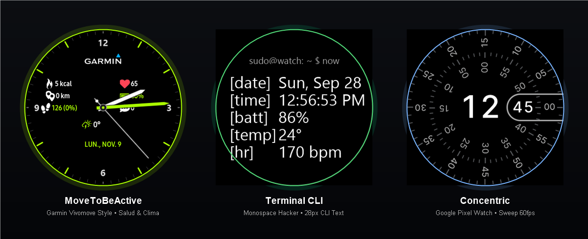

# Reloj Galaxy Watch 3 Tizen



Colección completa de carátulas nativas de alto rendimiento optimizadas para la pantalla circular AMOLED de **360×360 px** del **Samsung Galaxy Watch 3 (`SM-R840`, Tizen OS 5.5.0.2)**, con scripts de instalación automatizada vía Wi-Fi (SDB) tanto de forma individual como en carrusel triple.

---

## 📸 Muestra Visual de las Carátulas

| **MoveToBeActive (Garmin Vivomove)** | **Terminal Watchface (28px CLI)** | **Concentric (Google Pixel)** |
|:---:|:---:|:---:|
|  |  |  |
| *Analógico híbrido con suite de salud y clima* | *Consola minimalista hacker a 28 px* | *Doble disco concéntrico fluido a 60 fps* |

---

## 🌟 Características de las Carátulas

### 1. MoveToBeActive (Estilo Garmin Vivomove)
- **Directorio:** [`tizen-native-movetobeactive/`](tizen-native-movetobeactive/)
- **Slot Nativo:** `com.samsung.watchface-noblesse-a7`
- **Dial:** Fondo negro puro AMOLED (`#000000`), 60 marcas con índices horarios en verde lima Vivomove (`#AAFF00`) en horas 1, 2, 4, 5, 7, 8, 10 y 11; numerales `12`, `3`, `6` y `9`.
- **Manecillas:** Horaria blanca biselada, minutero verde lima y segundero mecánico con animación de latido continuo (`animation="tick"`).
- **Logotipo:** Insignia oficial de `GARMIN` con triángulo cian/azul (`#00C4FF`).
- **Métricas en Vivo:**
  - **Izquierda:** Calorías (`pedometer.activeCalorie`), Distancia (`pedometer.distance`), Pasos (`pedometer.step`).
  - **Derecha:** Ritmo Cardíaco (`heartrate.recent` bpm), Batería (`battery.percent%`), Notificaciones (`notification.count`).
  - **Inferior:** Clima (icono dinámico + `weather.currentTemperature°`), Ciudad (`weather.cityName`), Fecha completa interactiva (`EEE, MMM d`).
- **AOD (Always-On Display):** Consumo ultra bajo (< 15% OPR) con manecillas optimizadas e indicadores esenciales.

---

### 2. Terminal Watchface (28 px)
- **Directorio:** [`tizen-native-terminal/`](tizen-native-terminal/)
- **Slot Nativo:** `com.samsung.watchface-noblesse-u1`
- **Diseño:** Fuente monoespaciada aumentada a **28 px** (`A1T0232`), con etiquetas alineadas uniformemente a 6 caracteres:
  - `[date]` — Fecha interactiva (abre Calendario).
  - `[time]` — Hora digital en formato 12h/24h con segundos parpadeantes (abre Alarma).
  - `[batt]` — Nivel y estado de batería en % (abre Estado de Batería).
  - `[temp]` — Temperatura meteorológica actual (abre Clima).
  - `[hr]  ` — Frecuencia cardíaca en tiempo real (abre Ritmo Cardíaco).

---

### 3. Concentric (Google Pixel Watch)
- **Directorio:** [`tizen-native-concentric/`](tizen-native-concentric/)
- **Slot Nativo:** `com.samsung.watchface-noblesse-u6`
- **Diseño:**
  - Anillo exterior de segundos con barrido fluido continuo a 60 fps (`second.millisecond`).
  - Anillo interior de minutos con rotación suave.
  - Cápsula central con hora digital en gran tamaño (92 px).
  - 4 complicaciones en los cuadrantes: batería, pasos, calorías activas y clima.

---

## 🚀 Guía de Instalación en el Reloj vía SDB (Wi-Fi)

Asegúrate de que la depuración SDB esté activada en el reloj (**Ajustes > Acerca del reloj > Depuración activada**) y conectado a la misma red Wi-Fi:

### Opción 1: Instalar solo MoveToBeActive
- **En Windows (PowerShell):**
  ```powershell
  .\install_movetobeactive.ps1 -DeviceIp "192.168.100.77:26101"
  ```
- **En Linux / macOS / Git Bash:**
  ```bash
  chmod +x install_movetobeactive.sh
  ./install_movetobeactive.sh 192.168.100.77:26101
  ```

---

### Opción 2: Instalar solo Terminal Watchface
- **En Windows (PowerShell):**
  ```powershell
  .\install_terminal.ps1 -DeviceIp "192.168.100.77:26101"
  ```
- **En Linux / macOS / Git Bash:**
  ```bash
  chmod +x install_terminal.sh
  ./install_terminal.sh 192.168.100.77:26101
  ```

---

### Opción 3: Instalar solo Concentric
- **En Windows (PowerShell):**
  ```powershell
  .\install_concentric.ps1 -DeviceIp "192.168.100.77:26101"
  ```
- **En Linux / macOS / Git Bash:**
  ```bash
  chmod +x install_concentric.sh
  ./install_concentric.sh 192.168.100.77:26101
  ```

---

### Opción 4: Desplegar el Carrusel Triple Completo (Recomendado)
Instala las 3 carátulas simultáneamente y las deja activas para alternar entre ellas con el bisel físico del reloj:
- **En Windows (PowerShell):**
  ```powershell
  .\instalar_todas_las_caratulas.ps1 -DeviceIp "192.168.100.77:26101"
  ```
- **En Linux / macOS / Git Bash:**
  ```bash
  chmod +x instalar_todas_las_caratulas.sh
  ./instalar_todas_las_caratulas.sh 192.168.100.77:26101
  ```

---

## 🔄 Cómo alternar entre carátulas en el reloj
Mantén presionada la pantalla del reloj durante **2 segundos**. Se abrirá el selector interactivo mostrando la miniatura de cada carátula. Gira el **bisel físico** o desliza el dedo hacia los lados para elegir la que desees usar.
