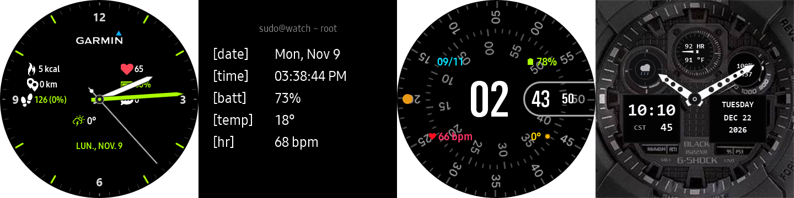
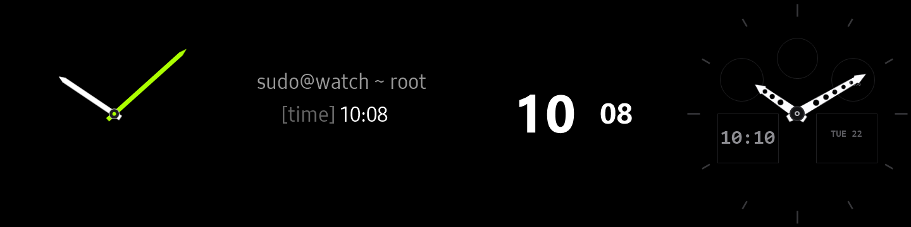

# Reloj Galaxy Watch 3 Tizen



Colección completa de carátulas nativas de alto rendimiento optimizadas para la pantalla circular AMOLED de **360×360 px** del **Samsung Galaxy Watch 3 (`SM-R840`, Tizen OS 5.5.0.2)**, con scripts de instalación automatizada vía Wi-Fi (SDB) tanto de forma individual como en carrusel cuádruple.

---

## 📸 Muestra Visual de las Carátulas (Pantalla Activa)

| **MoveToBeActive (Garmin)** | **Terminal CLI (34px)** | **Concentric (Pixel Quad)** | **G-Shock GA-100 (TacBlack)** |
|:---:|:---:|:---:|:---:|
|  |  |  |  |
| *Analógico híbrido con suite de salud y clima* | *Consola minimalista hacker CLI 34px* | *Doble disco concéntrico fluido a 60 fps* | *Táctico militar ana-digi con manecillas esqueleto* |

---

## 🌙 Modo Siempre Encendido (AOD / Ambient Display)



Diseño ultralimpio sobre fondo negro puro AMOLED (`#000000`) con píxeles físicamente apagados para máxima autonomía y protección contra quemado de pantalla (*burn-in*):

| **MoveToBeActive (AOD)** | **Terminal CLI (AOD)** | **Concentric (AOD)** | **G-Shock GA-100 (AOD)** |
|:---:|:---:|:---:|:---:|
|  |  |  |  |
| *Manecillas analógicas flotantes* | *sudo@watch ~ root + [time] 34px* | *Números centrales de hora y minutos* | *Lume tenue en manecillas + LCDs apagados* |

---

## 🌟 Características de las Carátulas

### 1. G-Shock GA-100 TacBlack (Militar Táctico Ana-Digi)
- **Directorio:** [`tizen-native-ga100-tacblack/`](tizen-native-ga100-tacblack/)
- **Slot Nativo:** `com.samsung.watchface-noblesse-a8`
- **Origen:** Inspirado en *TacBlack* de **joeheeger** (Facer), recreación táctica oficial del icónico **Casio G-Shock GA-100-1A1 "Military Black / Stealth"**.
- **Arquitectura Ana-Digi (Dual Dial):**
  - **Manecillas Esqueleto Tácticas:** Agujas principales troqueladas (*drilled skeleton*) en blanco puro con borde carbón y centro perforado que deja ver la esfera inferior.
  - **Sub-dial Superior (12:00 - Tacómetro / Velocímetro):** Muestra el pulso cardíaco en tiempo real (`heartrate.recent HR`), temperatura ambiente (`weather.currentTemperature°`) y aguja tacométrica que rota dinámicamente con el ritmo cardíaco.
  - **Sub-dial Izquierdo (10:00 - Radar Meteorológico):** Retícula táctica con icono meteorológico en vivo (sol, lluvia, nubes).
  - **Sub-dial Derecho (02:00 - Medidor de Rendimiento):** Batería en porcentaje (`battery.percent%`) y pasos totales del día (`pedometer.step`) sobre escala de velocidad `1000 500`.
  - **LCD Inferior Izquierdo (08:00 - Reloj Negativo):** Hora digital nítida (`HH:mm`), abreviatura de zona horaria (`timezone.abbr`) y segundos continuos (`second.padded`).
  - **LCD Inferior Derecho (04:00 - Calendario Completo):** Día de la semana en mayúsculas (`EEEE`), mes y día (`MMM d`), y año actual (`yyyy`).
  - **Fondo Táctico Texturizado:** Bisel tridimensional con grabado `G-SHOCK`, marcas horarias en gris sigiloso y textura central tipo panal (*carbon waffle*).
- **AOD (Always-On Display):** Fondo negro absoluto AMOLED (`#000000`), agujas con lume suave y números digitales tenues en bajo consumo (OPR < 1.8%).

---

### 2. MoveToBeActive (Estilo Garmin Vivomove)
- **Directorio:** [`tizen-native-movetobeactive/`](tizen-native-movetobeactive/)
- **Slot Nativo:** `com.samsung.watchface-noblesse-a7`
- **Dial:** Fondo negro puro AMOLED (`#000000`), 60 marcas con índices horarios en verde lima Vivomove (`#AAFF00`) en horas 1, 2, 4, 5, 7, 8, 10 y 11; numerales `12`, `3`, `6` y `9`.
- **Manecillas:** Horaria blanca biselada, minutero verde lima y segundero mecánico con animación de latido continuo (`animation="tick"`).
- **Logotipo:** Insignia oficial de `GARMIN` con triángulo cian/azul (`#00C4FF`).
- **Métricas en Vivo:** Calorías kcal, distancia km, pasos y porcentaje diario, ritmo cardíaco, batería, notificaciones pendientes, clima y ciudad.
- **AOD:** Manecillas flotantes sobre negro puro AMOLED (OPR < 2.5%).

---

### 3. Terminal Watchface (Linux CLI 34px)
- **Directorio:** [`tizen-native-terminal/`](tizen-native-terminal/)
- **Slot Nativo:** `com.samsung.watchface-noblesse-u1`
- **Encabezado:** `sudo@watch ~ root` en pantalla activa y AOD.
- **Diseño:** Consola monoespaciada hacker con etiquetas alineadas:
  - `[date]` — Fecha interactiva (abre Calendario).
  - `[time]` — Hora digital en formato 12h/24h con segundos parpadeantes (abre Alarma).
  - `[batt]` — Nivel y estado de batería en % (abre Estado de Batería).
  - `[temp]` — Temperatura meteorológica actual (abre Clima).
  - `[hr]  ` — Frecuencia cardíaca en tiempo real (abre Ritmo Cardíaco).
- **AOD:** Minimalismo absoluto con `sudo@watch ~ root` y la hora (`[time]`) en tipografía nativa de **34 px** (`AT24002`).

---

### 4. Concentric (Google Pixel Watch)
- **Directorio:** [`tizen-native-concentric/`](tizen-native-concentric/)
- **Slot Nativo:** `com.samsung.watchface-noblesse-u6`
- **Diseño:**
  - Anillo exterior de segundos con barrido fluido continuo a 60 fps (`second.millisecond`).
  - Anillo interior de minutos con rotación suave.
  - Cápsula central con hora digital en gran tamaño (92 px).
  - 4 complicaciones limpias y simétricas: fecha ("DIA/MES"), batería con porcentaje explícito (`XX%`), frecuencia cardíaca con icono de corazón y temperatura meteorológica.
- **AOD:** Píldora horizontal minimalista con números de hora y minutos en tono blanco/gris suave.

---

## 🚀 Guía de Instalación Rápida Paso a Paso

### 1. Requisitos Previos en tu Computadora
- Disponer de la herramienta **SDB (Samsung Smart Development Bridge)** en el PATH o en la carpeta del proyecto.
- Disponer de PowerShell en Windows o Bash en macOS/Linux.

---

### 2. Preparar el Galaxy Watch 3
1. **Activar Opciones de Desarrollador:**
   - En el reloj ve a **Ajustes > Información del reloj > Software**.
   - Pulsa repetidamente sobre **Versión de software** unas 5 a 7 veces hasta que aparezca el aviso *"El modo de desarrollador está activado"*.
2. **Activar Depuración SDB:**
   - Regresa al menú anterior y entra a **Opciones de desarrollador** (al final de la lista).
   - Busca **Depuración** y asegúrate de que esté en **Activado**.
3. **Conectar a la misma red Wi-Fi:**
   - Ve a **Ajustes > Conexiones > Wi-Fi**.
   - Configura el Wi-Fi en **Siempre activado** y conéctate a la **misma red Wi-Fi** donde está tu computadora.
4. **Consultar la IP del Reloj:**
   - En **Ajustes > Conexiones > Wi-Fi**, pulsa sobre tu red Wi-Fi conectada y baja hasta ver **Dirección IP** (ejemplo: `192.168.100.77`).
5. **Reiniciar el Reloj (Obligatorio en Tizen):**
   - Mantén presionado el botón inferior derecho (**Power/Home**) durante 8 segundos hasta que la pantalla muestre *"Reiniciando..."* (Rebooting).

---

### 3. Conexión y Autorización RSA (Primera Vez)
1. Con el reloj reiniciado y con la pantalla encendida, ejecuta en tu terminal:
   ```bash
   sdb connect <IP_DEL_RELOJ>:26101
   ```
2. En la pantalla del reloj aparecerá la confirmación RSA:
   > **"¿Permitir depuración SDB desde este equipo?"**  
   - Marca la casilla **"Permitir siempre desde este equipo"** y pulsa la palomita **✔**.
3. Confirma la conexión con:
   ```bash
   sdb devices
   ```

---

### 4. Scripts de Instalación

#### 🏆 Opción 1: Carrusel Cuádruple Completo (Recomendado)
Instala las 4 carátulas simultáneamente en el reloj y las deja disponibles en el carrusel para alternar entre ellas con el bisel físico:
- **En Windows (PowerShell):**
  ```powershell
  .\instalar_todas_las_caratulas.ps1 -DeviceIp "TU_IP:26101"
  ```
- **En Linux / macOS / Git Bash:**
  ```bash
  chmod +x instalar_todas_las_caratulas.sh
  ./instalar_todas_las_caratulas.sh TU_IP:26101
  ```

---

#### 🪖 Opción 2: Instalar solo G-Shock GA-100 TacBlack
- **PowerShell:** `.\install_ga100_tacblack.ps1 -DeviceIp "TU_IP:26101"`
- **Bash:** `./install_ga100_tacblack.sh TU_IP:26101`

#### ⏱️ Opción 3: Instalar solo MoveToBeActive (Garmin)
- **PowerShell:** `.\install_movetobeactive.ps1 -DeviceIp "TU_IP:26101"`
- **Bash:** `./install_movetobeactive.sh TU_IP:26101`

#### 💻 Opción 4: Instalar solo Terminal Watchface (Linux CLI)
- **PowerShell:** `.\install_terminal.ps1 -DeviceIp "TU_IP:26101"`
- **Bash:** `./install_terminal.sh TU_IP:26101`

#### 🔵 Opción 5: Instalar solo Concentric (Pixel Watch)
- **PowerShell:** `.\install_concentric.ps1 -DeviceIp "TU_IP:26101"`
- **Bash:** `./install_concentric.sh TU_IP:26101`

---

## 🔄 Cómo alternar entre carátulas en el reloj
Mantén presionada la pantalla del reloj durante **2 segundos**. Se abrirá el selector interactivo mostrando la miniatura de cada carátula. Gira el **bisel físico** o desliza el dedo hacia los lados para elegir la que desees usar.

---

## 🌙 Configuración del Modo Siempre Encendido (AOD)
1. **Activar AOD:** Desliza hacia abajo desde el borde superior de la pantalla y toca el icono de reloj.
2. **Ajustar Brillo Legible:** Ve a **Ajustes > Pantalla > Brillo** y selecciona nivel **5 o 6**.
3. **Uso en Muñeca:** El Galaxy Watch 3 activa el AOD automáticamente al estar colocado en la muñeca (cubriendo el sensor trasero).
