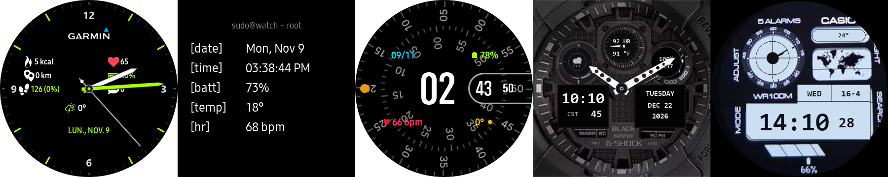
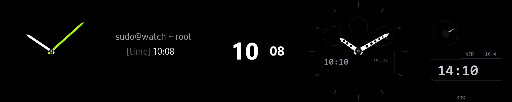

# Reloj Galaxy Watch 3 Tizen



Colección completa de 5 carátulas nativas de alto rendimiento optimizadas para la pantalla circular AMOLED de **360×360 px** del **Samsung Galaxy Watch 3 (`SM-R840`, Tizen OS 5.5.0.2)**, con nombres personalizados en el carrusel y scripts de instalación automatizada vía Wi-Fi (SDB).

---

## 📸 Muestra Visual de las Carátulas (Pantalla Activa)

| **MoveToBeActive** | **Terminal Linux** | **Concentric Pixel** | **G-Shock GA-100** | **Casio Royale** |
|:---:|:---:|:---:|:---:|:---:|
|  |  |  |  |  |
| *Analógico deportivo Garmin* | *Consola hacker CLI 34px* | *Doble disco Pixel 60 fps* | *Militar táctico ana-digi* | *James Bond World Time* |

---

## 🌙 Modo Siempre Encendido (AOD / Ambient Display)



Diseño ultralimpio sobre fondo negro puro AMOLED (`#000000`) con píxeles físicamente apagados para máxima autonomía y protección contra quemado de pantalla (*burn-in*):

| **MoveToBeActive (AOD)** | **Terminal Linux (AOD)** | **Concentric Pixel (AOD)** | **G-Shock GA-100 (AOD)** | **Casio Royale (AOD)** |
|:---:|:---:|:---:|:---:|:---:|
|  |  |  |  |  |
| *Manecillas flotantes* | *[time] centrado en 34px* | *Hora y minutos centrales* | *Lume tenue en manecillas* | *Marco LCD y hora tenue* |

---

## 🌟 Las 5 Carátulas y sus Nombres en el Reloj

| Carátula | Nombre en Pantalla (`DisplayName`) | Ranura Nativa Tizen | Estilo Principal |
| :--- | :--- | :--- | :--- |
| **Casio Royale AE-1200** | `Casio Royale` | `com.samsung.watchface-noblesse-u3` | Digital Retro / Planisferio Mundial |
| **G-Shock GA-100 TacBlack** | `G-Shock GA-100` | `com.samsung.watchface-noblesse-a8` | Táctico Militar Ana-Digi |
| **MoveToBeActive** | `MoveToBeActive` | `com.samsung.watchface-noblesse-a7` | Híbrido Salud / Garmin Vivomove |
| **Terminal Watchface** | `Terminal Linux` | `com.samsung.watchface-noblesse-u1` | Hacker CLI Minimalista 34px |
| **Concentric** | `Concentric Pixel` | `com.samsung.watchface-noblesse-u6` | Google Pixel Watch a 60 fps |

---

### 1. Casio Royale AE-1200 (World Time)
- **Directorio:** [`tizen-native-casio-royale/`](tizen-native-casio-royale/)
- **Slot Nativo:** `com.samsung.watchface-noblesse-u3`
- **Nombre en Reloj:** `Casio Royale`
- **Características:**
  - **Reloj Analógico LCD (10:00):** Mini-esfera con marcas de 60 segundos, retícula (*crosshairs*) y manecillas analógicas digitales sincronizadas con la hora local.
  - **Píldora del Clima (01:00):** Logotipo `CASIO` con temperatura exterior en vivo (`24°`) e icono dinámico de estado del tiempo.
  - **Mapa Planisferio (02:30):** El mapa mundial clásico con husos horarios.
  - **Recuadro de Fecha (03:00):** Día de la semana (`WED`) y fecha Día-Mes (`16-4`).
  - **Reloj Principal (06:00):** Hora y minutos digitales grandes (`14:10`) y segundero continuo en sub-ventana (`28`).
  - **Barra de Batería (06:30):** Bloques segmentados de progreso de batería y porcentaje exacto (`66%`).
  - **Bisel Perimétrico:** Marcas de botones `ADJUST`, `MODE`, `LIGHT`, `SEARCH`, `5 ALARMS` y `WR 100M`.

---

### 2. G-Shock GA-100 TacBlack (Militar Táctico Ana-Digi)
- **Directorio:** [`tizen-native-ga100-tacblack/`](tizen-native-ga100-tacblack/)
- **Slot Nativo:** `com.samsung.watchface-noblesse-a8`
- **Nombre en Reloj:** `G-Shock GA-100`
- **Características:**
  - Manecillas esqueleto troqueladas (*drilled skeleton*) en blanco puro con centro perforado transparente.
  - Sub-dial superior con pulso cardíaco en tiempo real (`HR`), temperatura y aguja tacométrica dinámica.
  - Radar meteorológico, medidor de batería/pasos, y doble pantalla LCD negativa con hora y calendario completo.

---

### 3. MoveToBeActive (Garmin Vivomove)
- **Directorio:** [`tizen-native-movetobeactive/`](tizen-native-movetobeactive/)
- **Slot Nativo:** `com.samsung.watchface-noblesse-a7`
- **Nombre en Reloj:** `MoveToBeActive`
- **Características:** Analógico deportivo con suite completa de métricas de salud (calorías, distancia, pasos con porcentaje, frecuencia cardíaca, batería, notificaciones y clima).

---

### 4. Terminal Watchface (Linux CLI 34px)
- **Directorio:** [`tizen-native-terminal/`](tizen-native-terminal/)
- **Slot Nativo:** `com.samsung.watchface-noblesse-u1`
- **Nombre en Reloj:** `Terminal Linux`
- **Características:** Consola monoespaciada tipo shell con encabezado `sudo@watch ~ root`, métricas de sistema alineadas y AOD centrado en 34 px.

---

### 5. Concentric (Google Pixel Watch)
- **Directorio:** [`tizen-native-concentric/`](tizen-native-concentric/)
- **Slot Nativo:** `com.samsung.watchface-noblesse-u6`
- **Nombre en Reloj:** `Concentric Pixel`
- **Características:** Anillos concéntricos giratorios a 60 fps con hora central de 92 px y 4 complicaciones simétricas.

---

## 🚀 Instalación Automatizada vía Wi-Fi (SDB)

### 🏆 Opción 1: Carrusel Quíntuple Completo (Recomendado)
Instala las 5 carátulas simultáneamente en el reloj y configura sus nombres personalizados:
- **En Windows (PowerShell):**
  ```powershell
  .\instalar_todas_las_caratulas.ps1 -DeviceIp "TU_IP:26101"
  ```
- **En Linux / macOS / Git Bash:**
  ```bash
  chmod +x instalar_todas_las_caratulas.sh
  ./instalar_todas_las_caratulas.sh TU_IP:26101
  ```

---

### Instalación Individual de cada Carátula
- **Casio Royale:** `.\install_casio_royale.ps1 -DeviceIp "TU_IP:26101"`
- **G-Shock GA-100:** `.\install_ga100_tacblack.ps1 -DeviceIp "TU_IP:26101"`
- **MoveToBeActive:** `.\install_movetobeactive.ps1 -DeviceIp "TU_IP:26101"`
- **Terminal Linux:** `.\install_terminal.ps1 -DeviceIp "TU_IP:26101"`
- **Concentric:** `.\install_concentric.ps1 -DeviceIp "TU_IP:26101"`

---

## 🔄 Cómo alternar entre carátulas en el reloj
Mantén presionada la pantalla del reloj durante **2 segundos**. Verás aparecer cada una de las 5 carátulas con su **nombre real** en la parte superior (`Casio Royale`, `G-Shock GA-100`, `MoveToBeActive`, `Terminal Linux`, `Concentric Pixel`). Gira el bisel físico para elegir tu favorita.
